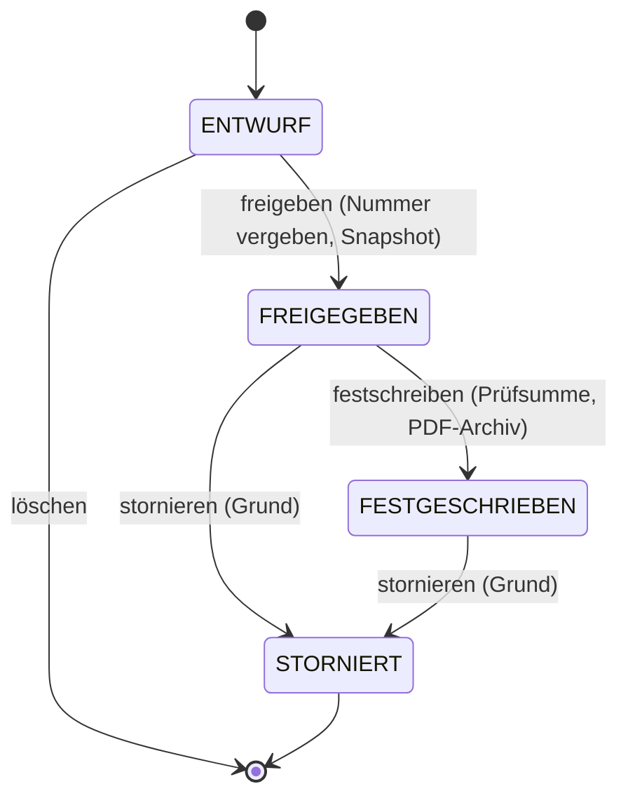
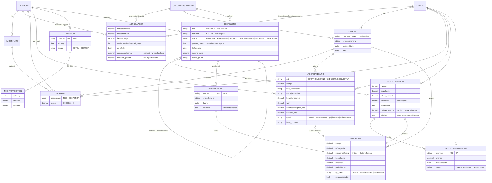
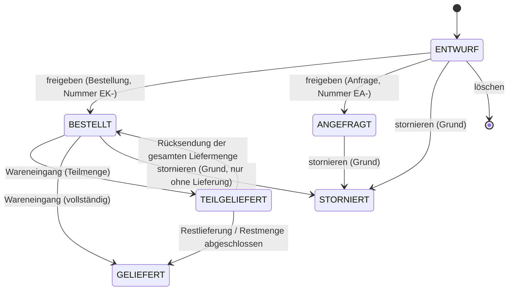

# Datenmodell – Phase 1 und 2

Stand: Phase 2 (Warenfluss). Lager, Einkauf und Wareneingang siehe Abschnitt [Phase 2](#phase-2--lager-einkauf-wareneingang). Tabellennamen folgen dem Django-Schema `<app>_<modell>`
(z. B. `belege_beleg`). Primärschlüssel ist jeweils `id` (bigint). Geldbeträge sind `numeric` (Decimal),
nie Gleitkomma.

## Übersicht

```mermaid
erDiagram
    USER ||--o{ ROLLE_BENUTZER : "hat"
    ROLLE ||--o{ ROLLE_BENUTZER : "umfasst"
    ROLLE ||--o{ RECHT : "besitzt"
    MODUL ||--o{ RECHT : "wird geregelt durch"
    USER ||--o{ AUDITLOG : "verursacht"

    EINHEIT ||--o{ ARTIKEL : "Mengeneinheit"
    STEUERSATZ ||--o{ ARTIKEL : "Umsatzsteuer"
    ZAHLUNGSBEDINGUNG ||--o{ GESCHAEFTSPARTNER : "Standard"
    GESCHAEFTSPARTNER ||--o{ ADRESSE : "hat"
    GESCHAEFTSPARTNER ||--o{ ANSPRECHPARTNER : "hat"
    ARTIKEL ||--o{ STUECKLISTE : "wird gefertigt nach"
    STUECKLISTE ||--o{ STUECKLISTENPOSITION : "enthält"
    ARTIKEL ||--o{ STUECKLISTENPOSITION : "ist Komponente in"
    ARTIKEL ||--o{ ARBEITSPLAN : "wird gefertigt mit"
    ARBEITSPLAN ||--o{ ARBEITSGANG : "besteht aus"

    GESCHAEFTSPARTNER ||--o{ BELEG : "Empfänger/Absender"
    ZAHLUNGSBEDINGUNG ||--o{ BELEG : "gilt für"
    BELEG ||--o{ BELEGPOSITION : "enthält"
    ARTIKEL ||--o{ BELEGPOSITION : "optional"
    USER ||--o{ BELEG : "erstellt/freigegeben/festgeschrieben/storniert"
    BELEG |o--o| BELEG : "Vorgänger in Hash-Kette (über Prüfsumme)"

    MANDANT {
        string name
        string strasse
        string plz
        string ort
        string ust_id
        string steuernummer
        string handelsregister
        string iban
        string bic
        string kontenrahmen "SKR03 oder SKR04"
    }
    MODUL {
        slug code UK
        string name
        bool aktiv
        bool pflicht
        int reihenfolge
        string url_name
        json geplant
    }
    ROLLE {
        string name UK
        text beschreibung
    }
    RECHT {
        fk rolle
        fk modul
        bool lesen
        bool anlegen
        bool aendern
        bool freigeben
        bool loeschen
    }
    NUMMERNKREIS {
        slug code UK "z. B. BELEG_RECHNUNG"
        string praefix
        bool jahresbezogen
        int stellen
        int naechste_nummer
        int aktuelles_jahr
    }
    AUDITLOG {
        datetime zeitpunkt
        fk benutzer
        string aktion "anlegen/aendern/loeschen/zuordnung"
        string app_label
        string modell
        string objekt_id
        json aenderungen "Feld: alt -> neu"
    }
    ARTIKEL {
        string artikelnummer UK
        string bezeichnung
        string art "ROHSTOFF/HALBZEUG/WERKZEUG/BETRIEBSMITTEL/FERTIGARTIKEL/HANDELSWARE"
        fk einheit
        bool chargenpflicht
        fk steuersatz
        decimal einkaufspreis
        decimal verkaufspreis
        decimal gewicht_kg
        string ean
        string zolltarifnummer
    }
    GESCHAEFTSPARTNER {
        string nummer UK "aus Nummernkreis PARTNER"
        string name
        bool ist_kunde
        bool ist_lieferant
        string ust_id
        string leitweg_id
        string gln
        fk zahlungsbedingung
        string debitorenkonto
        string kreditorenkonto
    }
    ADRESSE {
        fk partner
        string typ "HAUPT/RECHNUNG/LIEFER"
        string strasse
        string plz
        string ort
        string land
    }
    ANSPRECHPARTNER {
        fk partner
        string vorname
        string nachname
        string funktion
        string email
    }
    STUECKLISTE {
        fk artikel
        int version
        decimal basismenge
        bool aktiv
    }
    STUECKLISTENPOSITION {
        fk stueckliste
        int position
        fk komponente
        decimal menge
    }
    ARBEITSPLAN {
        fk artikel
        int version
        bool aktiv
    }
    ARBEITSGANG {
        fk arbeitsplan
        int position
        string arbeitsplatz
        decimal ruestzeit_min
        decimal stueckzeit_min
        string lohngruppe
        bool akkordfaehig
    }
    KONTO {
        string kontenrahmen "SKR03/SKR04"
        string nummer
        string bezeichnung
        string kontoart
    }
    STEUERSATZ {
        string code UK
        decimal satz
    }
    ZAHLUNGSBEDINGUNG {
        string code UK
        int tage_netto
        int skonto_tage
        decimal skonto_prozent
    }
    BELEGVORLAGE {
        string name
        string belegart "leer = Standard"
        text html "Django-Template"
        bool aktiv
    }
    BELEG {
        string belegart
        string nummer UK "erst ab Freigabe"
        string status "ENTWURF/FREIGEGEBEN/FESTGESCHRIEBEN/STORNIERT"
        fk partner
        json partner_daten "Adress-Snapshot ab Freigabe"
        date belegdatum
        date leistungsdatum
        decimal summe_netto
        decimal summe_steuer
        decimal summe_brutto
        int ketten_index UK "Position in der GoBD-Kette"
        string pruefsumme "SHA-256"
        string vorgaenger_pruefsumme
        file pdf "Archiv-PDF"
        string pdf_pruefsumme
        text storno_grund
    }
    BELEGPOSITION {
        fk beleg
        int position
        fk artikel
        string bezeichnung
        decimal menge
        string einheit
        decimal einzelpreis
        decimal rabatt_prozent
        decimal steuersatz "Wert zum Belegzeitpunkt"
        decimal betrag_netto
    }
```

`MANDANT`, `NUMMERNKREIS`, `KONTO`, `BELEGVORLAGE` haben keine Fremdschlüssel; Nummernkreise werden über
ihren `code` angesprochen (`PARTNER`, `BELEG_<BELEGART>`).

## Wichtige Regeln

| Bereich | Regel | Umsetzung |
|---|---|---|
| Rechte | Rolle × Modul × Aktion, Rechte mehrerer Rollen werden addiert | `core.permissions.rechte_fuer()` |
| Module | Inaktives Modul ist für alle gesperrt | Registry + Rechteprüfung |
| Nummernkreise | lückenlos, transaktionssicher, Jahreswechsel | `SELECT … FOR UPDATE` in `naechste_nummer()` |
| Belegnummer | wird erst bei Freigabe vergeben | `belege.services.freigeben()` |
| Steuersatz in Position | wird als Wert kopiert, nicht referenziert | spätere Satzänderungen verändern alte Belege nicht |
| Partneradresse im Beleg | Snapshot (`partner_daten`) ab Freigabe | Änderungen am Stamm wirken nicht rückwirkend |
| GoBD | festgeschriebene/stornierte Belege unveränderbar | Code-Sperre + PL/pgSQL-Trigger + Hash-Kette |
| Stücklisten | mehrstufig, zyklenfrei | `Stueckliste.aufloesen()` wirft `StuecklistenFehler` bei Zyklus |
| Löschen | Stammdaten mit Verwendung sind geschützt | `on_delete=PROTECT` |

## Beleg-Status



## Hash-Kette (GoBD)

```
pruefsumme(n) = SHA-256( vorgaenger_pruefsumme(n-1) | Kopfdaten | Positionen | Summen | Partner-Snapshot | Festschreibzeitpunkt | Ketten-Index )
```

Jede Manipulation an einem festgeschriebenen Beleg (auch per direktem SQL bei deaktiviertem Trigger) wird
bei der Kettenprüfung (Verwaltung → GoBD-Kettenprüfung) erkannt: Die Prüfsumme des Belegs stimmt dann nicht
mehr und die Verkettung zum Nachfolger bricht.

---

## Phase 2 – Lager, Einkauf, Wareneingang



### Regeln Phase 2

| Bereich | Regel | Umsetzung |
|---|---|---|
| Bestandsänderung | nur über eine Funktion, mit Journal | `lager.services.buchen()`; Sperre `SELECT … FOR UPDATE` auf `ArtikelLager` |
| Journal | unveränderlich, Korrektur nur per Gegenbuchung | `Lagerbewegung.save()/delete()` + Trigger `lager_bewegung_unveraenderlich` |
| Bestand | nie negativ, eindeutig je Artikel/Ort/Platz/Charge/Bestandsart | Check-Constraint, Unique-Constraint (`NULLS NOT DISTINCT`) |
| Bewertung | gleitender Durchschnitt; Abgang/Inventur-Minus zum Ø; Umbuchung ohne Wert | `buchen()` |
| Chargenpflicht | keine Buchung/kein Wareneingang ohne Charge | `buchen()`, `wareneingang.services.buchen()` |
| QS | QS-pflichtige Zugänge in Sperrbestand; Freigabe = Umbuchung GESPERRT → FREI | `wareneingang.services.qs_entscheiden()` |
| Nummern | BA-, EA-, EK- (bei Freigabe), WEB-, INV- | `naechste_nummer()` |
| Bestellstatus | aus gelieferten/erledigten Positionen abgeleitet | `einkauf.services.status_fortschreiben()` |
| Fibu-Kopplung | nur Event `wareneingang.gebucht` (nach Commit) | Abonnent in `apps/fibu/ereignisse.py` (Logging) |

### Bestellstatus


